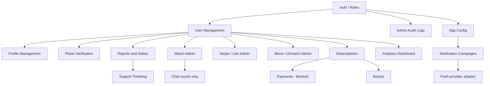

# Admin Implementation Plan

**Project:** Dating Cloud admin (`dating-cloud-admin` + `backend/`)  
**Audit date:** 2026-10-16  
**Scope:** Admin SPA and `/api/v1/admin` APIs only. The Flutter member app lives outside this workspace and must keep working unchanged.

---

## 1. Executive summary

An audit of this repository shows a working admin foundation, not a finished admin product.

**What exists today**

- React 19 + Vite 8 admin SPA with custom CSS, Recharts, Axios, and `react-router-dom`
- Express 5 + MongoDB/Mongoose 9 + JWT + Socket.IO API, with Vitest coverage under `backend/tests/admin/`
- Shared staff/member login via `POST /api/v1/auth/login`; staff roles `USER | MODERATOR | ADMIN` on the `User` model
- Admin API mounted at `/api/v1/admin` with MODERATOR/ADMIN gate and ADMIN-only routes for subscriptions, campaign create, audit logs, and settings

**Fully usable admin modules (FE + BE)**

- User Management (list / search / detail / status)
- Reports & Safety
- Support ticketing
- Admin Audit Logs

**Partial modules**

- Profile Management (read-only on user detail)
- Photo verification (selfie queue only; no government ID)
- Match (per-user matches with message counts; no global match browser)
- Chat (counts only — intentional)
- Subscriptions (ADMIN read-only)
- Notifications campaigns (inbox fan-out works; push not configured)
- Analytics (dashboard only)
- App Config/Settings (three numeric settings)
- Roles/Permissions (fixed three roles; no staff CRUD API)
- Security/Privacy (masking + role gates; incomplete ops surface)
- System Monitoring (public `/health` only)

**Not started / blocked**

- Swipe/Like admin, Block/Unmatch admin, Voice/Video Calls, Boosts, Banners/CMS, Offers/Coupons, Referral, AI/Fraud, Matchmaking admin, Location admin, Email/SMS admin, Growth/Experiments
- Payments: **Integration blocked** (store verification not configured; admin must not invent card storage)

Do not treat Phase 2–7 as complete. Work remaining is additive on top of existing patterns.

---

## 2. Architecture (reuse existing patterns)

```
dating-app/                          # Admin SPA (dating-cloud-admin)
  src/api/                           # Axios clients per domain
  src/pages/                         # Route pages
  src/components/                    # Shared UI
  src/routes/                        # AppRoutes + ProtectedRoute

backend/
  src/routes/admin.routes.js         # /api/v1/admin mount
  src/controllers/admin.controller.js
  src/services/admin/*.service.js    # Domain services + adminPresenter.js
  src/validators/admin.validator.js
  src/middlewares/auth.middleware.js # requireAuth + requireRole
  src/models/                        # Shared with member APIs
  tests/admin/                       # Vitest + Supertest
```

**Conventions to preserve**

| Layer | Pattern |
| --- | --- |
| Auth | JWT Bearer; role re-read from MongoDB on each request (not trusted from token claims alone) |
| Responses | `{ success, data, meta: { requestId } }` via `ApiResponse` |
| Lists | Cursor pagination `?cursor=&limit=` (default 20, max 50) → `{ items, nextCursor }` |
| Writes | Validate in `admin.validator.js` → service → `recordAudit` |
| Presentation | `adminPresenter.js` for user cards, contact masking, profile review shapes |
| FE auth | Shared login; `ProtectedRoute` + optional `roles={['ADMIN']}` |
| Rate limits | Admin router: 300 req/min per user |

New admin features should extend these layers rather than introducing a parallel stack.

---

## 3. Module map and dependencies



| Module | Depends on | Status |
| --- | --- | --- |
| 1. User Management | Auth, User, Profile | Implemented |
| 2. Profile Management | User detail | Partial |
| 3. Photo verification | Media, VerificationRequest | Partial |
| 4. Swipe/Like admin | Swipe (member APIs exist) | Not started |
| 5. Match | Match, Message counts | Partial |
| 6. Chat | Match / Conversation | Partial (counts only) |
| 7. Voice/Video Calls | *(no domain models)* | Not started |
| 8. Subscriptions | SubscriptionEntitlement | Partial |
| 9. Payments | External store | Integration blocked |
| 10. Boosts | *(no models)* | Not started |
| 11. Reports & Safety | Report | Implemented |
| 12. Block/Unmatch admin | Block, Match (member APIs exist) | Not started |
| 13. Notifications campaigns | NotificationCampaign, Device | Partial |
| 14. Banners/CMS | *(static FAQs in catalog)* | Not started |
| 15. Offers/Coupons | *(no models)* | Not started |
| 16. Referral | *(no models)* | Not started |
| 17. Support ticketing | SupportTicket | Implemented |
| 18. AI/Fraud | *(no models)* | Not started |
| 19. Matchmaking admin | Discovery / Profile | Not started |
| 20. Location admin | Profile.location *(hidden from admin)* | Not started (correctly restricted) |
| 21. Analytics | Dashboard aggregates | Partial |
| 22. App Config/Settings | AppSetting (3 keys) | Partial |
| 23. Roles/Permissions | User.role enum | Partial |
| 24. Security/Privacy | Masking, role gates | Partial |
| 25. Email/SMS admin | *(no admin surface)* | Not started |
| 26. System Monitoring | `/api/v1/health` | Partial |
| 27. Admin Audit Logs | AuditLog | Implemented |
| 28. Growth/Experiments | *(no models)* | Not started |

---

## 4. Phase plan (1–7)

Phases close gaps first, then add social-graph admin, monetization, content/growth, advanced safety, and platform ops. **Phases 2–7 are planned, not complete.**

### Phase 1 — Close foundation gaps

**Goal:** Finish identity, staff, and profile-moderation gaps on the current stack.

| Work item | Notes |
| --- | --- |
| Staff lifecycle | Create / list / update / deactivate MODERATOR and ADMIN accounts (ADMIN-only). Seed script exists (`npm run seed:admin`); no staff CRUD API yet. |
| Profile photo moderation writes | Today profiles are read-only on user detail. Add audited remove/hide photo actions without breaking member media APIs. |
| Roles/Permissions hardening | Keep fixed roles `USER \| MODERATOR \| ADMIN`; document ADMIN-only surfaces; optional staff invite + force logout. |
| Verification backlog | Selfie queue remains; government ID is out of scope until a provider and model exist. |

**Already done in this phase’s domain:** User list/search/detail/status, reports, support, audit logs, selfie verification review, dashboard, settings (3 keys), notification campaigns (no push).

### Phase 2 — Social graph admin

| Work item | Notes |
| --- | --- |
| Global / filtered matches list | Beyond per-user `GET /admin/users/:userId/matches` |
| Swipe / Like admin lists | Read from existing `Swipe` model; member discovery APIs stay intact |
| Block / Unmatch admin | Read/manage via existing `Block` + match end flows; mirror member safety semantics |

### Phase 3 — Monetization (honest adapters)

| Work item | Notes |
| --- | --- |
| Subscriptions UX polish | Remain read-only for entitlements unless store webhooks are real |
| Payments | **Blocked** until store verification is configured; adapter returns `FEATURE_NOT_CONFIGURED` |
| Boosts | New additive model + admin list/grant only after product rules are defined |
| Offers / Coupons | Planned `Coupon` model (additive) |

### Phase 4 — Content & growth

| Work item | Notes |
| --- | --- |
| Banners / CMS | Planned `CmsContent`; replace or complement static `FAQS` in `catalog.js` |
| Notification push | Wire push adapter; keep inbox fan-out; record real `pushStatus` |
| Referral | Planned `ReferralCode` |
| Growth / Experiments | Planned `Experiment` |

### Phase 5 — Communications (privacy-preserving)

| Work item | Notes |
| --- | --- |
| Chat admin | Keep **counts / metadata only** — no unrestricted chat browser |
| Voice / Video Calls | Requires new domain models; not present today |
| Email / SMS admin | Provider adapters; no secrets in settings responses |

### Phase 6 — Trust & matching intelligence

| Work item | Notes |
| --- | --- |
| AI / Fraud | Planned `UserRiskSignal`; human review still required |
| Matchmaking admin | Tuning / overrides without exposing exact member geolocation |
| Location admin | Exact coordinates stay hidden from admin presenters (current behaviour is correct) |

### Phase 7 — Platform operations

| Work item | Notes |
| --- | --- |
| Analytics expansion | Beyond dashboard aggregates (export, funnels) |
| App Config expansion | More non-secret settings under `EDITABLE_SETTINGS` |
| Security / Privacy | Retention, export/erase ops surfaces, stricter staff access reviews |
| System Monitoring | Authenticated admin health/metrics beyond public `GET /api/v1/health` |

---

## 5. Design decisions (non-negotiable)

1. **No unrestricted chat access** — Admin may see match metadata and message counts, never a free-form conversation browser of member message bodies (report targets remain the exception for moderation).
2. **No raw biometrics** — Selfie media for verification only; no government ID / biometric templates unless a future provider and legal policy land.
3. **No card storage** — Payments stay store-mediated; admin never stores PAN/CVV; unconfigured billing stays `FEATURE_NOT_CONFIGURED`.
4. **Adapters for unconfigured providers** — Push, store verification, social sign-in: fail honestly with feature flags / status fields, do not fake success.
5. **Preserve mobile APIs** — Member routes under `/api/v1` (discovery, chat, safety, subscriptions, etc.) must remain stable; admin work is additive under `/api/v1/admin`.
6. **No destructive schema changes** — Additive fields/collections only; see `ADMIN_DATABASE_CHANGES.md`.
7. **Audit every staff write** — Continue `recordAudit` on status changes, report updates, verification reviews, ticket replies, campaigns, settings.

---

## 6. Naming and folder conventions

| Kind | Convention | Example |
| --- | --- | --- |
| Admin route | kebab path under `/api/v1/admin` | `/admin/support/tickets` |
| Controller | handlers in `admin.controller.js` (split only when file grows too large) | `listUsers` |
| Service | `backend/src/services/admin/admin<Domain>.service.js` | `adminUsers.service.js` |
| Validator | `validators/admin.validator.js` functions | `validateStatusChange` |
| Model | PascalCase file + mongoose model | `VerificationRequest.js` |
| IDs | Prefixed string ids | `usr_`, `rep_`, `ver_`, `tkt_`, `aud_`, `ncp_` |
| FE API module | `src/api/<domain>.api.js` | `users.api.js` |
| FE page | `src/pages/<Name>Page.jsx` | `UsersPage.jsx` |
| Tests | `backend/tests/admin/<domain>.test.js` | `users.test.js` |
| Roles | Exact enums | `USER`, `MODERATOR`, `ADMIN` |

---

## 7. What to implement next

**Immediate (finish Phase 1 gaps)**

1. Staff lifecycle API + admin UI (ADMIN-only): create staff, list staff, change staff role/status, invalidate sessions.
2. Profile photo moderation writes on user detail (remove/hide photo) with audit trail and member-safe media status updates.
3. Tests in `backend/tests/admin/` for the new endpoints; update `ADMIN_API_DOCUMENTATION.md` and `ADMIN_PROGRESS.md` when landed.

**Then Phase 2**

4. Admin lists for matches (global), swipes/likes, and blocks/unmatch — read-mostly, reusing `Match`, `Swipe`, `Block`.

**Explicitly not next**

- Payments UI that pretends billing works
- Unrestricted chat browser
- Exact location exposure in admin profiles
- Claiming Phase 2–7 complete without code

---

## 8. Related documents

| File | Purpose |
| --- | --- |
| `ADMIN_PROGRESS.md` | Module checklist and resume notes |
| `ADMIN_API_DOCUMENTATION.md` | Existing admin endpoints |
| `ADMIN_DATABASE_CHANGES.md` | Models, indexes, planned additive schemas |
| `ADMIN_TEST_RESULTS.md` | Test suite status and how to run |
